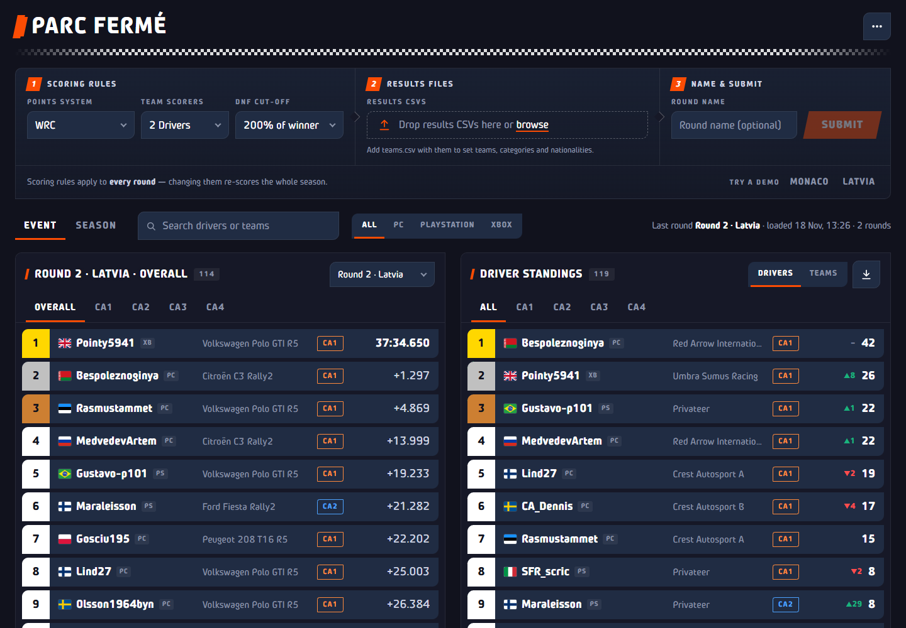
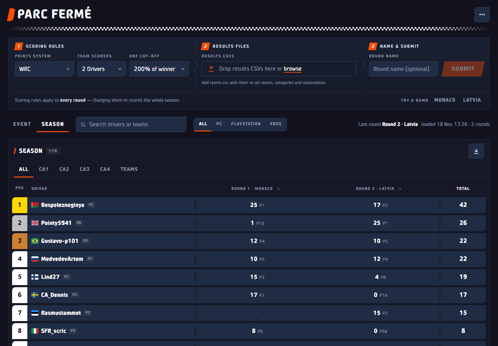
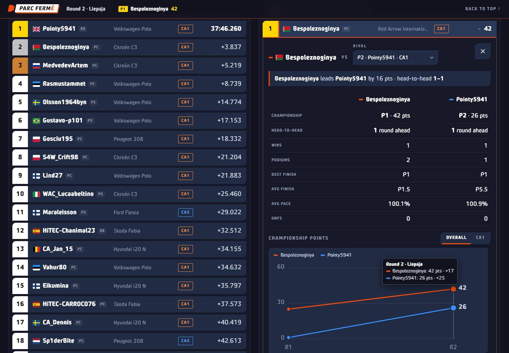
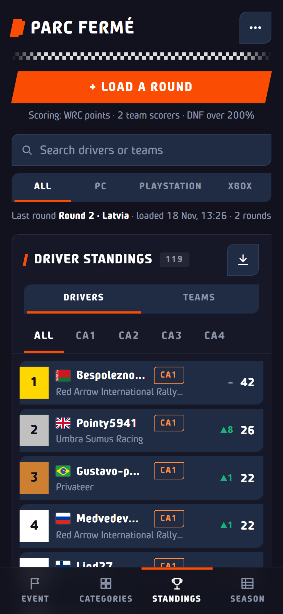

# Parc Fermé

**[Live demo → autoleaderboard.netlify.app](https://autoleaderboard.netlify.app/)**

A championship manager for sim rally leagues, inspired by Racenet. Upload the results CSVs from each round, and it scores the season using real motorsport points systems. It then builds the event results, driver, team and per-category standings, and a full season table.



## Features

- **Round history.** Every round you load is kept, and the standings are calculated from all of them. Change the points system and the whole season is re-scored. Remove a round and its points go with it. Loading the same results twice is detected and refused.
- **Points systems:** WRC, WRC Power Stage, Rallycross, F1, F1 Sprint and Crest, with 2, 3 or 4 scoring drivers per team.
- **Categories (CA1–CA4).** Each category has its own results and its own driver standings, scored on finishing position within the category. Team standings use the overall results. Privateers don't count as a team.
- **DNF cut-off.** Times slower than a set percentage of the winner's time (150%, 200% or 300%) are shown as DNF and score no points.
- **Season table.** A driver-by-round grid of points and positions, with category and team views.
- **Driver profiles.** Click any driver's row to open their profile right under it. It shows their championship and category position, wins, podiums, best finish, average pace, their result in each round, and a points chart that switches between overall and category points. Pick a second driver to compare them side by side, with both on the chart and a head-to-head count.
- **Sharing.** Export standings as an image in the app's styling, ready to post on Discord or social media, or export any table as CSV.
- **Filters.** Search drivers and teams, and filter by platform (PC, PlayStation, Xbox). Nationality flags and platform badges come from the teams and results files.
- **Mobile.** Bottom tab navigation, a collapsible upload panel, and two-line rows that fit a phone screen.

| Season table | Driver profile & compare | Mobile |
| --- | --- | --- |
|  |  |  |

## Using it

The **Load a round** panel walks through three steps:

1. **Scoring rules.** Pick the points system, the number of team scorers and the DNF cut-off. These apply to every round, so changing them re-scores the whole season straight away.
2. **Results files.** Drop in that round's results CSVs exported from Racenet (for example `Rally2.csv` and `WRC2.csv`). Several files are combined into one round, ranked by time. Add a `teams.csv` alongside them, which only needs uploading once, to give each driver their team, category, nationality and platform. The app reads these columns by header name: `RaceNet Name`, `Team Name`, `Category`, `NAT` and `Platform`.
3. **Name & submit.** Give the round a name, such as "Round 3 · Kenya", and submit.

To try it without your own files, use **Try a demo → Monaco / Latvia**.

Data is saved in your browser's `localStorage`. Nothing is uploaded to a server.

## Development

Built with React 18 and Vite, styled with plain CSS (no UI framework). CSV parsing uses [PapaParse](https://www.papaparse.com/) and flags come from [flag-icons](https://flagicons.lipis.dev/).

```bash
npm install
npm run dev        # dev server with hot reload
npm test           # unit tests (Vitest)
npm run build      # production build in dist/
npm run preview    # serve the production build locally
```

Deployed on [Netlify](https://autoleaderboard.netlify.app/). `netlify.toml` runs `npm run build` and publishes `dist/`.

### Project layout

```
src/
  lib/          parsing, scoring and export logic (plain JS, unit-tested)
    csv.js          results / teams CSV parsing
    season.js       round scoring, DNFs, categories, season totals
    exporters.js    standings image (canvas) and CSV export
  components/   React UI (panels, season table, driver drawer, chart, …)
  hooks/        localStorage state, media queries, FLIP reorder animation
public/demoresults/   demo rounds and teams file
```
